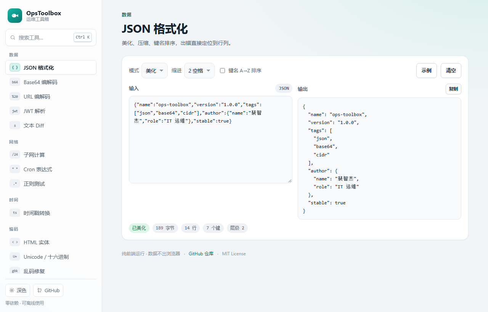
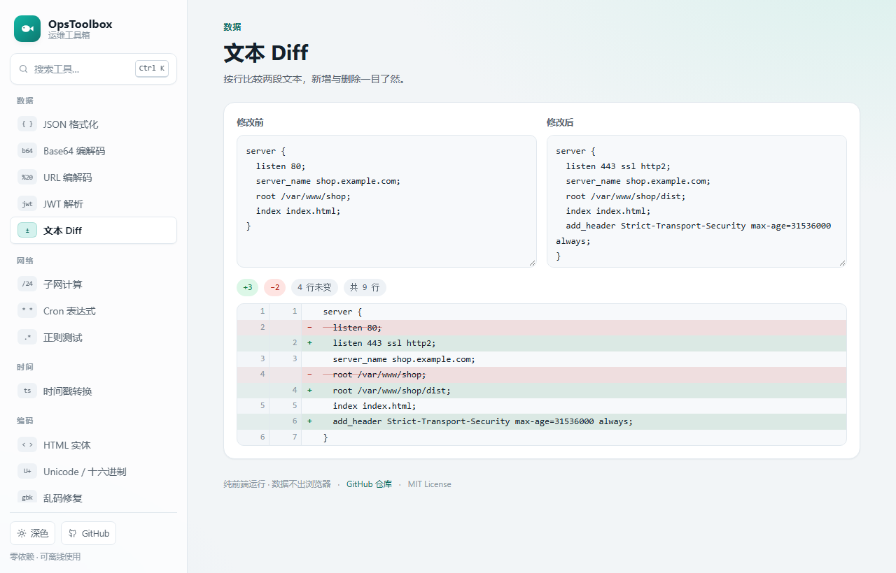
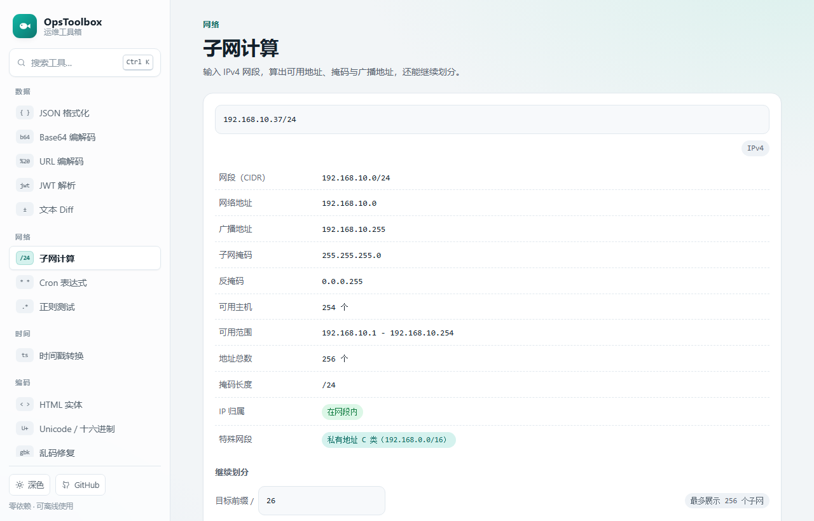
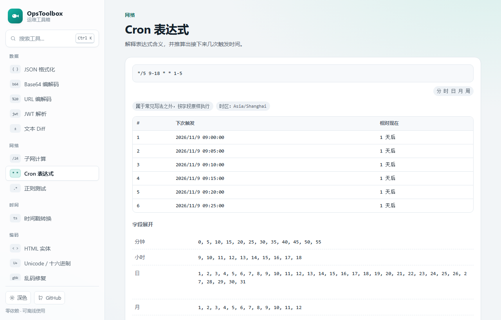
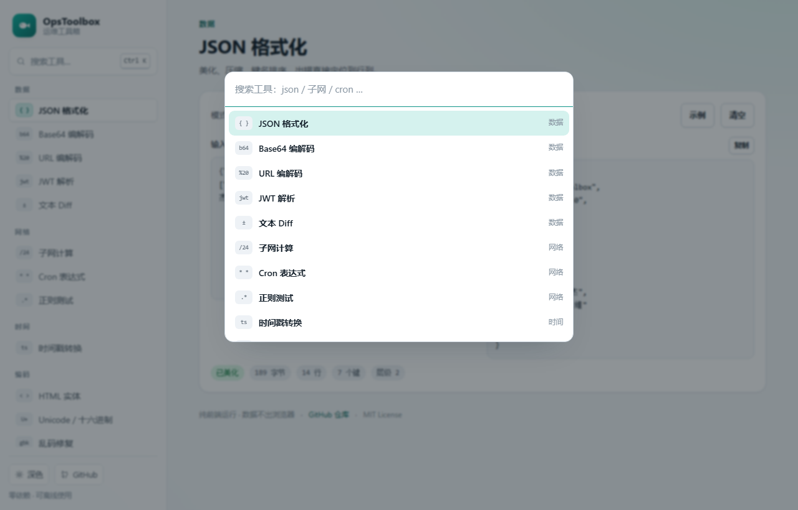
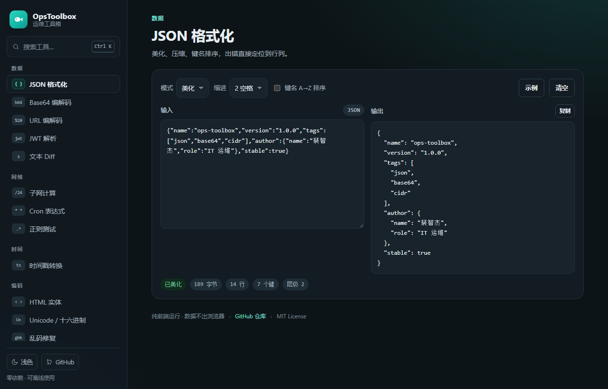

# OpsToolbox · 运维工具箱

> 14 个运维 / 开发高频小工具，纯前端运行，数据不离开浏览器。

**在线试用 → <https://pzj060726-png.github.io/ops-toolbox/>**

[](https://pzj060726-png.github.io/ops-toolbox/)
[](https://github.com/pzj060726-png/ops-toolbox/actions/workflows/ci.yml)
[](./LICENSE)
[](./package.json)
[](./assets/app.js)



## 为什么做这个

排查线上问题时，经常要临时处理一段 JSON、算个子网、算时间戳或者看 Cron 下次触发时间。
现成的在线工具站往往广告多、加载慢，还要求把配置和日志粘贴到别人的服务器上。

这个项目是我的自留地版本：**零依赖、零构建、零上传**，克隆下来就能用，也能直接挂到 GitHub Pages 上。

- 全部逻辑在浏览器本地执行，不发起任何网络请求；
- 没有框架、没有打包器，`index.html` + `assets/` 就是全部前端；
- 核心逻辑写在 `src/tools/` 里，和界面彻底解耦，由 Node 原生测试跑 73 个用例。

## 快速开始

```bash
npm start          # → http://127.0.0.1:4173
```

`npm start` 用的是仓库自带的静态服务器（`tools/serve.mjs`，约 60 行、零依赖），不用安装任何东西。

> 页面用的是原生 ES module，浏览器会拦截 `file://` 下的模块加载，所以请通过本地服务或 Pages 打开，
> 不要直接双击 `index.html`。换成别的静态服务器（`python -m http.server` 之类）也可以。

## 工具清单

| 工具 | 能做什么 |
| --- | --- |
| **JSON 格式化** | 美化 / 压缩 / 键名 A→Z 排序；出错时精确定位到行列，并给出上下文片段 |
| **Base64 编解码** | 文本与二进制安全处理、URL-safe 变体、非法输入校验 |
| **URL 编解码** | 逐个组件编码或整串编码；遇到坏掉的 `%XX` 会尽力恢复 |
| **JWT 解析** | 拆开 Header / Payload / Signature，检查 `exp` / `nbf` / `iat` |
| **文本 Diff** | 行级 LCS 对比，双列行号 + 增删高亮，超大文本自动降级提示 |
| **子网计算** | CIDR 全量信息（网络/广播/掩码/反掩码/可用范围），还能继续划分成子网 |
| **Cron 表达式** | 常见写法给中文描述，推算未来 6 次触发时间，并展开每个字段的取值 |
| **正则测试** | 实时高亮匹配、列出分组与命名分组、支持替换预览 |
| **时间戳转换** | 秒/毫秒自动识别，任意时区展示 ISO / RFC / 周数 / 一年中第几天 / 相对时间 |
| **HTML 实体** | 转义与反转义，避免配置里的尖括号被当成标签 |
| **Unicode / 十六进制** | 中文与 Emoji ↔ `\uXXXX` ↔ 十六进制字节 |
| **乱码修复** | 把被当成单字节编码显示的文本，按 UTF-8 / GBK / BIG5 重新解码 |
| **文本处理** | 字符 / 行 / 汉字 / 单词统计，排序、去重、去空行、反转 |
| **随机密码** | 使用 `crypto.getRandomValues` 生成，附信息熵与强度评估 |

## 界面

- **Ctrl / ⌘ + K** 打开命令面板，输入工具名或关键词即可跳转；
- 深浅色主题跟随系统，也可以手动切换（`?theme=dark` 可强制指定，方便截图与嵌入）；
- 深链接直达某个工具：`#/cidr`、`#/cron`、`#/jwt` ……

<table>
  <tr>
    <td width="50%"></td>
    <td width="50%"></td>
  </tr>
  <tr>
    <td width="50%"></td>
    <td width="50%"></td>
  </tr>
  <tr>
    <td width="50%"></td>
    <td width="50%"></td>
  </tr>
</table>

## 目录结构

```
ops-toolbox/
├─ index.html            # 唯一的页面外壳
├─ assets/
│  ├─ app.js             # 界面层：导航、路由、命令面板、14 个工具面板
│  ├─ style.css          # 设计令牌 + 组件样式（深浅色两套变量）
│  ├─ favicon.svg
│  └─ screenshots/       # README 用截图
├─ src/tools/            # 核心逻辑，纯函数、无 DOM、可被 Node 直接 import
│  ├─ index.js           # 统一出口
│  ├─ json.js  base64.js  url.js  jwt.js  diff.js
│  ├─ cidr.js  cron.js    regex.js time.js
│  └─ encode.js text.js   password.js
├─ test/                 # node:test 用例（73 个）
├─ tools/
│  ├─ serve.mjs          # 零依赖静态服务器
│  └─ check.mjs          # 模块导出自检
└─ .github/workflows/    # CI 与 GitHub Pages 部署
```

### 为什么这样分层

界面层只负责取值、拼 DOM、渲染结果，所有「算」的部分都在 `src/tools/` 里，
每个模块导出纯函数并返回 `{ ok, ... }` 形式的结果对象。
好处是：写测试不需要浏览器，改界面不会碰坏算法，算法改错会被 CI 拦住。

```js
import { analyzeCidr } from "./src/tools/cidr.js";

const info = analyzeCidr("192.168.10.37/24");
info.network;   // "192.168.10.0"
info.hostCount; // 254
```

## 开发

```bash
npm test            # 跑全部单元测试（node:test，无第三方测试框架）
npm run test:watch  # 监听模式
npm run check       # 校验 src/tools/*.js 是否都能正常导出
npm start           # 本地预览
```

新增一个工具大概四步：

1. 在 `src/tools/` 写纯函数模块并导出；
2. 在 `test/` 补用例（正常路径 + 边界 + 错误输入）；
3. 在 `assets/app.js` 写一个 `renderXxx()` 面板，登记到 `TOOLS` 数组；
4. 跑 `npm test && npm run check`，再 `npm start` 看一眼界面。

详细约定见 [CONTRIBUTING.md](./CONTRIBUTING.md)。

## 发布到 GitHub

仓库里给了两种方式，任选其一。

**A. 用脚本（推荐）**

```powershell
# 本机还没有 git 时先装一个
winget install --id Git.Git -e --source winget

powershell -ExecutionPolicy Bypass -File tools\publish.ps1 -Owner 你的GitHub用户名
```

脚本会依次做这些事：把 `README.md` / `package.json` 里的 `your-github-name` 换成你的用户名 →
`git init` 并提交 → 装了 [GitHub CLI](https://cli.github.com/) 时直接建仓、推送并顺手开启 Pages；
没装 `gh` 时打印出剩下的手动命令。

**B. 手动**

```bash
git init -b main
git add -A && git commit -m "chore: 初始化 OpsToolbox"
git remote add origin https://github.com/<你的用户名>/ops-toolbox.git
git push -u origin main
```

> 别忘了把 `README.md` 与 `package.json` 里的 `your-github-name` 换成你的用户名，
> 否则徽章与仓库链接会指向不存在的地址。

## 部署到 GitHub Pages

仓库自带 `.github/workflows/pages.yml`，两种方式任选：

**A. Actions 部署（推荐）**

1. 把代码 push 到 GitHub 的 `main` 分支；
2. 仓库 **Settings → Pages → Build and deployment → Source** 选择 **GitHub Actions**；
3. 之后每次 push 到 `main` 都会自动发布到 `https://<你的用户名>.github.io/ops-toolbox/`。

**B. 分支部署**

在 **Settings → Pages** 里选择 **Deploy from a branch**，分支 `main`、目录 `/`，保存即可。

> 小贴士：`assets/app.js` 顶部的 `REPO_URL` 是侧边栏 GitHub 链接的兜底地址。
> 部署在 GitHub Pages 上时会自动识别用户名与仓库名，本地打开则用这个常量，改成你自己的仓库即可。

## 浏览器兼容

Chrome / Edge 90+、Firefox 90+、Safari 15+。
用到了 `TextDecoder`、`crypto.getRandomValues`、`color-mix()`，太老的浏览器上配色与编码功能会退化。

## 许可

[MIT](./LICENSE) © 裴智杰

---

<details>
<summary>English</summary>

**OpsToolbox** is a zero-dependency, build-free collection of 14 operations / developer tools
(JSON formatter, Base64, URL codec, JWT decoder, text diff, CIDR calculator, cron explainer,
regex tester, timestamp converter, HTML entities, Unicode/hex, mojibake repair, text utilities,
password generator). Everything runs locally in the browser — nothing is uploaded.

```bash
npm start   # http://127.0.0.1:4173
npm test    # 73 unit tests via node:test
```

Deploy by pointing GitHub Pages at the repository root (or enable the bundled Actions workflow). MIT licensed.
</details>
